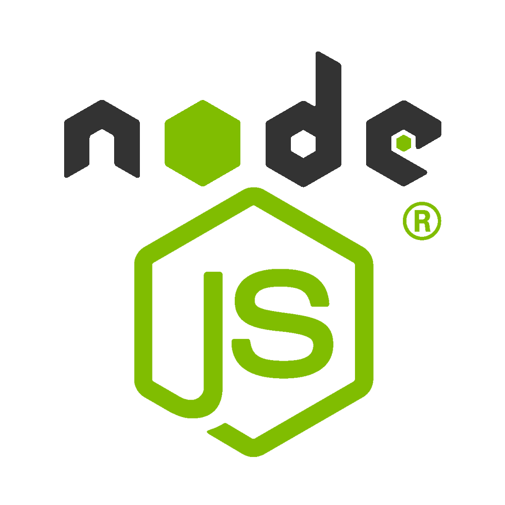

# Chief Software Engineer @ [Riseup Asia LLC](https://riseup-asia.com/ "Listed among the top 1% companies in California and Los Angeles for remote hiring across the Asian region. Served 137+ clients last year alone despite being a startup.")

## Jan 2025 to present (1.5+ years)

### [Back](../alim-ul-karim-profile.md)

## Technology Stack

Also: MERN (6+ yrs), RAG Embedding (Go, Python), LLM Integration, Vector Embedding, Split SQLite Architecture, AI voice-to-text, Rust, CLI Tools, REST APIs, MSSQL, Redis.

## Brand

A US-incorporated software studio, [Riseup Asia LLC](https://riseup-asia.com/) is listed among the **top 1% companies in California and Los Angeles for remote hiring across the Asian region**. Despite being a startup, the firm **served 137+ clients in the last year alone** [^riseup-clients]. Md. Alim Ul Karim (aka Md Alim Ul Karim) leads its engineering as Chief Software Engineer (Jan 2025 to present), shipping AI-first developer tooling, spec / agent orchestration platforms, and high-throughput backend services across Node.js, .NET, Python and Golang.

[^riseup-clients]: Source: [Riseup Asia LLC](https://riseup-asia.com/) . internal 2025 client roster (137+ engagements delivered in the trailing 12 months).

## Responsibilities and Achievements

1. **Spec Management Software + AI / LLM Orchestrator + Error Management platform** . Chief Software Engineer, full-stack ownership. Node.js, MERN, TypeScript, AI voice-to-text, .NET, Golang, Rust, Python, React, RAG Embedding, LLM Integration, Split SQLite Architecture, Vector Embedding, CLI Tools, REST APIs. Designed and shipped the spec-driven planning engine plus the LLM orchestrator that routes prompts across multiple models with retry, fallback, and structured error surfacing.
2. **AI agentic coding workflows** . Stood up agent loops with deterministic tool invocation, evidence-enforced planning, and per-task subtask trees, cutting human review overhead while preserving auditability.
3. **Polyglot backend leadership** . Owns code-review standards across Node.js, .NET, Python and Golang . enforces typed boundaries, structured logging, and Rust-level safety patterns ported from prior Crossover / xproduct engagements.
4. **Split SQLite + Vector Embedding architecture** . Built a sharded SQLite + vector-store pipeline for fast local RAG retrieval with minimal infrastructure footprint.
5. **CLI tooling + REST APIs** . Delivered operator-grade CLI tools and REST surfaces wrapping the orchestrator so teams can script spec runs, error replay, and embedding refreshes.

## Team Members

Small focused team (1 to 5+ engineers) across spec/agent platform, LLM orchestrator, and CLI tooling tracks. Alim leads architecture, code review, and AI-pipeline design end to end.

## Engagements (sub-nodes)

1. *(none yet . sub-node files will land under `./001.Chief-Software-Engineer-Riseup-Asia/` as individual engagements are documented.)*

## Projects

### Spec Management Software + AI / LLM Orchestrator + Error Management

Spec-driven planning engine paired with a multi-model LLM orchestrator and an error-management surface. Routes prompts across providers with retry, fallback, structured error capture, and evidence-enforced audit trails. Stack: Node.js, MERN, TypeScript, AI voice-to-text, .NET, Golang, Rust, Python, React, RAG Embedding, LLM Integration, Split SQLite Architecture, Vector Embedding, CLI Tools, REST APIs.

### [Back](../alim-ul-karim-profile.md)

<!-- DISCLAIMER:START -->

---

> **Disclaimer.** Some passages here were rewritten by an automation tool from voice memos, so wording and figures can drift from the intended meaning despite the research behind them. Verify with the author, **Md.** "[Alim Ul Karim](https://alimkarim.com/)" ([LinkedIn](https://www.linkedin.com/in/alimkarim/)), before relying on a number. Riseup Asia LLC is not the publisher of this profile. See [DISCLAIMER](../disclaimer.md).

<!-- DISCLAIMER:END -->
