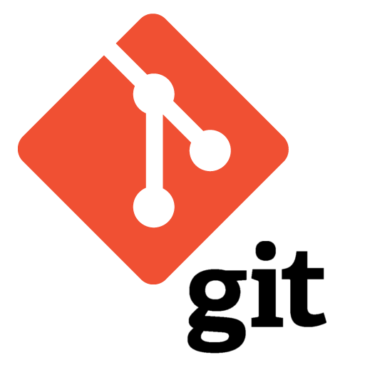

# Principal Software Engineer @ [the-xproduct.com](https://the-xproduct.com)

## May 2022 to Dec 2024 (2.5+ years, **done**)

### [Back](../alim-ul-karim-profile.md)

## Technology Stack

Also: Node.js (6+ yrs), MERN (6+ yrs), .NET Core (8+ yrs), SignalR (2+ yrs), Redis (10+ yrs), Onion Architecture, ChatGPT integration, Kafka, Azure EventBus, VueJS, ReactJS, Grafana, Selenium, AI Modeling.

## Brand

[the-xproduct.com](https://the-xproduct.com) is the umbrella under which Alim took principal-level engagements between May 2022 and Dec 2024. The platform concept is a configurable enterprise toolkit ("xbusiness-engines" similar in spirit to WordPress templates) with its own future compiler that can interoperate with Node.js, C# and Java.

## Responsibilities and Achievements

1. **EMR Product for USA** . Principal Software Engineer, 5-member team. NodeJS, C#, .NET Core, ReactJS, TypeScript, SignalR, LINQ, MSSQL, Azure, ChatGPT. Real-time EMR system: **40%** reduction in documentation time, **70%** higher claim acceptance. Refactored .NET SignalR component and built the MIPS module: **10%** code reduction, **100%** test coverage.
2. **Adtech for [TargetSpot](https://www.targetspot.com/) (Germany / Belgium) and Azerion (Belgium)** . Consultant and Senior Staff Software Engineer, 3-member team (Jan 2022 to Jul 2022, 7 months). C#, NodeJS, MERN, JavaScript, Azure, Azure Storage, LINQ, MSSQL, Redis, Grafana, VueJS, Onion Architecture, Jira. High-scale adtech: **8B+** monthly impressions, **35%** lower reporting latency. Debugged Belgium-side production failures live during interview and designed the system architecture on the spot, recovering **$100K+** in revenue.
3. **Azure EventBus + Kafka custom .NET data adapter** . Built to break a data-adapter bottleneck degrading performance **50%+**. Resulting framework improved ingestion speed by **49.5%**.
4. **Principal Software Engineer @ Validata Software Group (RM engagement, May 2022 to Mar 2023, 11 months)** . Azure, C#, Selenium, JavaScript, MSSQL, MongoDB, Redis. **30 to 40%** memory optimization on automated Selenium recording. Full detail: [sub-node](./02-software-architect-x-product/01-validata-rm.md).
5. **Sense AI 2.1 + ConnectIQ** . Principal Software Engineer, remote team (Jun 2023 to May 2024, 1 year). Azure, Azure Storage, C#, JavaScript, LINQ, MSSQL, Onion Architecture, Jira. **20x** faster end-to-end testing, **50x** smaller data footprint.
6. **€200K+ enterprise deal secured** by leading a 10-developer team integrating AI with a superior design strategy where weak architecture was previously blocking the deal.
7. **Legacy ATS refactor** . Rigorous review standards reduced bug rates by **94%**.
8. **Golang code-review guides** with Rust-level safety principles . **87%** code-quality improvement.

## Team Members

2+ to 10+ across engagements (see each item above).

## Engagements (sub-nodes)

1. [Principal Software Engineer @ Validata Software Group (May 2022 to Mar 2023, 11 months)](./02-software-architect-x-product/01-validata-rm.md). Azure, C#, Selenium, JavaScript, MSSQL, MongoDB, Redis.
2. [Principal Software Engineer . EMR Product for USA (Jul 2023 to Dec 2024, 1.5+ years)](./02-software-architect-x-product/02-emr-usa.md). NodeJS, C#, .NET Core, ReactJS, TypeScript, SignalR, LINQ, MSSQL, Azure, ChatGPT.
3. [Senior Staff Software Engineer & Consultant . TargetSpot (Germany / Belgium) and Azerion (Belgium) (Jan 2022 to Jul 2022, 7 months)](./02-software-architect-x-product/03-targetspot-azerion.md). C#, NodeJS, MERN, JavaScript, Azure, Azure Storage, LINQ, MSSQL, Redis, Grafana, VueJS, Onion Architecture.

## Projects

### [MVC Bootstrapper: building a system just got easy](https://www.thedailystar.net/bytes/mvc-bootstrapper-building-system-just-got-easy-120904)

Build enterprise systems **rapidly** and **efficiently** for hundreds of **thousands** of users out of the box. The solution is **ASP.NET MVC Bootstrapper**. It lets a developer be **productive** in both corporate and enterprise contexts without deep enterprise / large-user optimization expertise: the framework itself is optimized and scalable to hundreds of thousands of users, and works around key redundancies of the existing framework to offer a fully prepared web development platform.

### [Back](../alim-ul-karim-profile.md)

<!-- DISCLAIMER:START -->

---

> **Disclaimer.** This page is a researched but working draft assembled with dictated audio and an automation tool for editing. Anything you want to cite should be validated against a primary source or with the author, **Md.** "[Alim Ul Karim](https://alimkarim.com/)" on [LinkedIn](https://www.linkedin.com/in/alimkarim/). Riseup Asia LLC has no involvement in the writing. Full notice . [DISCLAIMER](../disclaimer.md).

<!-- DISCLAIMER:END -->
