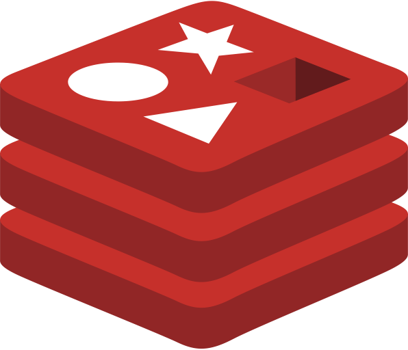

# Principal Software Engineer @ [Validata Software Group](https://www.validata-software.com) . Engagement via [the-xproduct.com](https://the-xproduct.com)

## May 2022 - Mar 2023 (11 months)

Signing starts from June 13.

### [← Back](../../alim-ul-karim-profile.md)

## Technology Stack

Also: **LINQ** (12+ yrs).

## Recommendations from Co-Workers

### [Konstantinos Chronis / Kostas](https://www.linkedin.com/in/konstantinos-chronis-18a8b0127)

__Current position:__ Senior Software Engineer at Validata

__Remarks__

I had the pleasure of working with Alim on multiple projects, and I highly recommend him as a software developer. He has a strong expertise in C#, unit testing and he always keeps code coverage in mind. Alim is a meticulous coder who ensures that his work meets the highest standards of quality. One particular achievement that stands out is his implementation of Azure storage, where he demonstrated a deep understanding of the technology and was able to design and build an efficient, scalable solution that exceeded our expectations.

Alim is also an excellent team player who communicates clearly and works collaboratively with others to achieve common goals. His positive attitude and willingness to lend his expertise to help solve problems make him a pleasure to work with. I am confident that he will be an asset to any team lucky enough to have him.

### [Michael Tzanettis](https://www.linkedin.com/in/michael-tzanettis-a36250147)
__Current position:__ Software Engineer at Validata

__Remarks__

I had the pleasure of working with Alim in Validata Group. Alim is a very smart Engineer and a hard-working person with excellent communication and mentoring skills. He understands complicated concepts and system architectures and he always makes sure that he shares the knowledge with his colleagues.

His knowledge of JavaScript and C# is exceptional. Furthermore, Alim worked on the Chrome addon Refactor which improve the quality of the code and memory consumption for Validata Sense AI for chrome addon. In infinity onboarding, the JavaScript and full input system along with onboarding which is 2/3 of the whole adapter is done by Alim.

Alim helped me a lot on various tasks throughout our meetings in the company and helped me improve my way of thinking in various aspects of engineering. He is also very polite and pleasurable to talk to. Once again it was pleasure working with him and hope to meet again. Farewell my friend.

### [Saleh Panna](https://www.linkedin.com/in/pannaahmed?lipi=urn%3Ali%3Apage%3Ad_flagship3_profile_view_base_recommendations_details%3BOlBWnveySxmMdWbBxXmawA%3D%3D)

__Current position:__ Developer at Unrevealed

__Remarks__

Alim is an architect/mentor with distinct design skills. I had the opportunity to have quite a few sessions with him and learned:

1. How to make code more readable.
2. How to write simple code from complex compound conditional arguments.
3. Why positive conditions are better than negative ones.
4. __JavaScript__ code refactoring including dealing with unknown and complex stuff in code.

Things he explained, explained with care and reference links so that it is easier to trust and learn as never forgettable topics.

## Responsibilities and Achievements

💡 Provide automatic __E2E__ recording and execution testing facilities for Temenos __T24__ software.

💡 Improved product performance in recording __memory__ consumption by __40%__ by refactoring Chrome Addon.

&nbsp;&nbsp;&nbsp;&nbsp;✔ However, this got wasted after new features are added.

💡 Deployed full audit log system in Azure Storage __SenseAI 2.1__ from scratch.

&nbsp;&nbsp;&nbsp;&nbsp;✔ Full team relies on the audit logs for executing issues.

&nbsp;&nbsp;&nbsp;&nbsp;✔ It is the single source of truth for the audit logs.

💡 Used __Selenium__ drivers to record and execute tests.

💡 Rewritten ATS functionality to __azure__ cloud cloud-based system.

💡 Refactoring the ATS old codes to modernize in terms of solid principles __(~5-10%)__, plus rewriting some of the old __ATS__ code for could based system.

💡 Created __TdhAdapter__ from scratch to support Azure EventBus, and Azure Kafka support with __Avro__ formats.

💡 Worked with Infinity, __T24__ web input recording adapter features (Menu, Input recording), applying better approach by and improved __50%__ per input form compared to __UXP__.
💡 ✔ Fixed unstable __bugs__ in the system (✖ not very proud of). As it is not part of the Principal Software Engineers' responsibility.

## Worked with Adapters

- Tdh Adapter (with Avro) - Fully created by Alim
- UXP Recording Adapter
- UXP Execution Adapter
  - Full Audit Log system written to Azure Storage.
  - Whole team depends on it.
- Csv FileSystem Adapter
  - Data exchange to Azure Storage
- Infinity Banking Adaper
- T24Web Adapter

## Team Members

- 💡 14+ team members.
- 💡 14+ software engineers & developers
- 💡 4+ QA Engineers

## Projects

### [`Sense AI - 2.1 release`](https://www.validata-software.com/products/validata-sense-ai)

#### Project Tech stack

           LINQ

#### Description

- __Improved__ product performance in recording memory consumption by __35%__.
- Completed __51__ tasks , QA approved in __2.5__ months timeframe.
- Fixing legacy and bugs in the new system (not very proud to do so).
- Total __execution__ aduit logs worked on by Alim.

### [`Connect IQ`](https://www.validata-software.com/products/connectiq)

#### Project Tech stack

        LINQ  

#### Description

- __Reduce__ data footprints by __50x__ and Provision data faster by __100x__.
- File base adapter, __CSV__ adapter, and new __dynamic__ adapter.

### [← Back](../../alim-ul-karim-profile.md)
