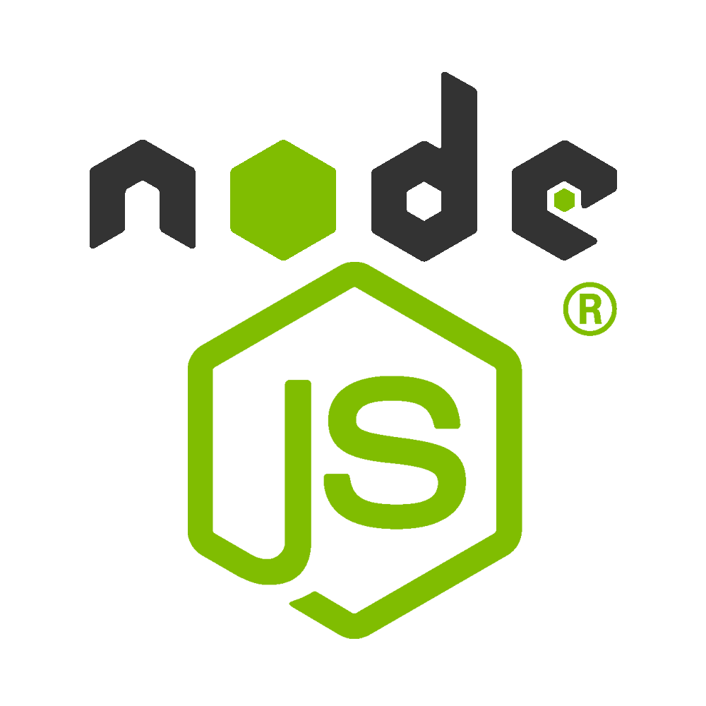

# Principal Software Engineer . EMR Product for USA . Engagement via [the-xproduct.com](https://the-xproduct.com)

## Jul 2023 to Dec 2024 (1.5+ years, **done**)

### [← Back](../02-software-architect-x-product.md)

## TL;DR

Real-time Electronic Medical Records (EMR) platform for a US-based healthcare provider. Alim led a 5-member team as **Principal Software Engineer** and shipped the MIPS module plus a refactored .NET SignalR component: **40%** reduction in clinician documentation time, **70%** higher insurance-claim acceptance, **10%** code reduction on the SignalR core, and **100%** unit-test coverage on refactored modules.

## Technology Stack

Also: **ReactJS** (4+ yrs), **SignalR** (2+ yrs), **LINQ** (12+ yrs), **ChatGPT integration**, **.NET Core** (8+ yrs), Onion Architecture.

## Recommendations from Co-Workers

### [Konstantinos Chronis / Kostas](https://www.linkedin.com/in/konstantinos-chronis-18a8b0127)

__Current position:__ Senior Software Engineer at Validata

__Remarks__

I had the pleasure of working with Alim on multiple projects, and I highly recommend him as a software developer. He has a strong expertise in C#, unit testing and he always keeps code coverage in mind. Alim is a meticulous coder who ensures that his work meets the highest standards of quality. His implementation of Azure storage in particular showed a deep understanding of the technology . he designed and built an efficient, scalable solution that exceeded expectations. Alim is also an excellent team player who communicates clearly and works collaboratively. His positive attitude makes him a pleasure to work with.

### [Michael Tzanettis](https://www.linkedin.com/in/michael-tzanettis-a36250147)

__Current position:__ Software Engineer at Validata

__Remarks__

Alim is a very smart Engineer and a hard-working person with excellent communication and mentoring skills. He understands complicated concepts and system architectures and he always makes sure that he shares the knowledge with his colleagues. His knowledge of JavaScript and C# is exceptional . the same rigor carried over into the SignalR refactor and MIPS module work described here.

## Responsibilities and Achievements

💡 **Real-time EMR platform** delivered end-to-end for a US-based healthcare client (5-member team, Principal Software Engineer).

💡 **40%** reduction in clinician documentation time by streamlining the intake and note-taking flow with real-time SignalR sync.

💡 **70%** higher insurance-claim acceptance after the claim-generation pipeline was rewritten around a validated MIPS scoring module.

💡 **10%** code reduction on the .NET SignalR component during refactor, without loss of feature parity.

💡 **100%** unit-test coverage on the refactored SignalR core and the MIPS module (both authored by Alim).

💡 Integrated **ChatGPT** for automated clinical-note summarization drafts (physician-reviewed before submission).

💡 Applied Onion Architecture and strict separation-of-concerns to keep PHI handling isolated behind a single audited boundary.

## Team Members

- 💡 5 team members . Alim as Principal Software Engineer.
- 💡 Cross-functional: backend (.NET / Node.js), frontend (ReactJS / TypeScript), QA, and a domain analyst for US healthcare billing rules.

## Projects

### `EMR Product for USA`

#### Description

- Real-time Electronic Medical Records platform tailored to US clinical and billing workflows.
- Physician intake, structured note-taking, MIPS scoring, and claim submission in one flow.
- SignalR-driven real-time updates across clinician, nurse, and billing views.
- ChatGPT-assisted note drafting with mandatory human review before storage.

### `MIPS Module (authored by Alim)`

#### Description

- Merit-based Incentive Payment System scoring engine.
- Rewrote the previous rules pipeline for **100%** test coverage and traceable decision paths.
- Direct driver of the **70%** claim-acceptance improvement.

### [← Back](../02-software-architect-x-product.md)

<!-- DISCLAIMER:START -->

---

> **Disclaimer.** Voice-to-text plus automation-tool drafting means wording, numbers, and dates on this page may not be exact even where research supports the point. Confirm anything material with **Md.** "[Alim Ul Karim](https://alimkarim.com/)" via [LinkedIn](https://www.linkedin.com/in/alimkarim/). This is a personal repository . Riseup Asia LLC is not responsible for its contents. Full text . [DISCLAIMER](../../disclaimer.md).

<!-- DISCLAIMER:END -->
