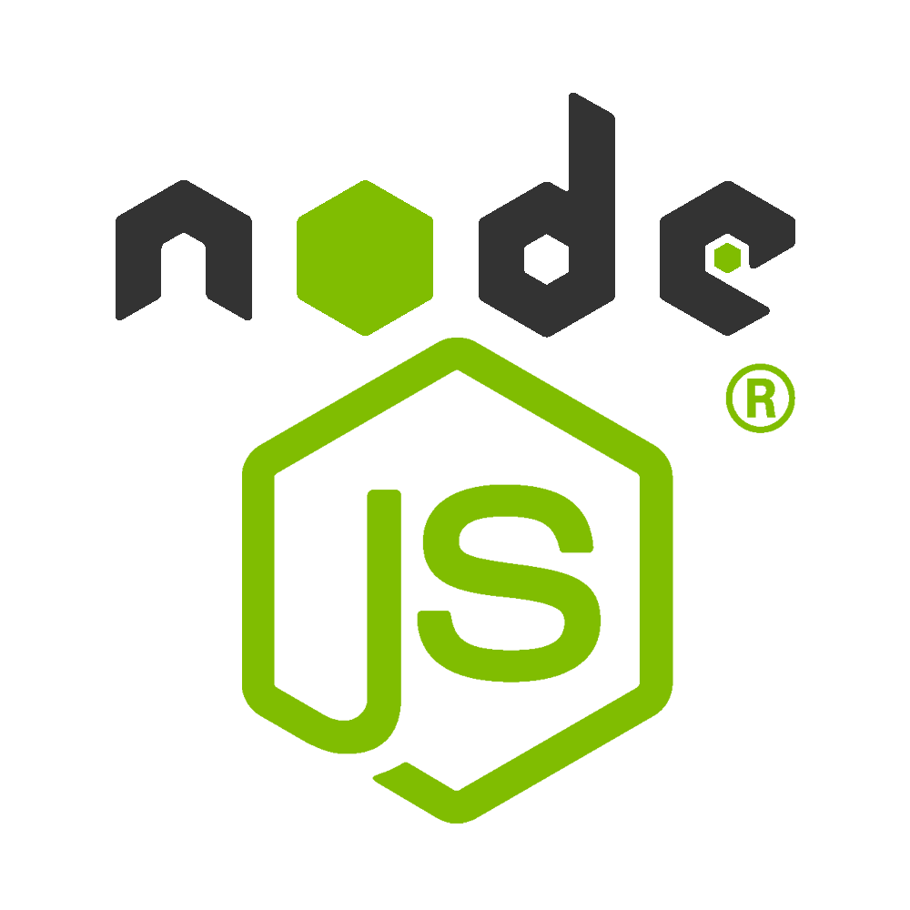
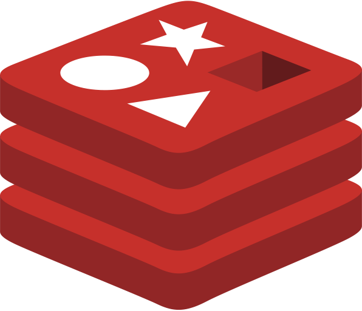

# Senior Staff Software Engineer & Consultant . Adtech for [TargetSpot](https://www.targetspot.com/) (Germany / Belgium) and Azerion (Belgium) . Engagement via [the-xproduct.com](https://the-xproduct.com)

## Jan 2022 to Jul 2022 (7 months, **done**)

### [← Back](../02-software-architect-x-product.md)

## TL;DR

High-scale European adtech engagement for [TargetSpot](https://www.targetspot.com/) (Germany / Belgium) and Azerion (Belgium). Alim served as **Consultant and Senior Staff Software Engineer** on a 3-member team. Highlights: **8B+** monthly ad impressions handled by the reporting pipeline, **35%** lower reporting latency, and a live production-debug during the interview itself that recovered **$100K+** in blocked revenue on the Belgium side and directly won the engagement.

## Technology Stack

Also: **MERN** (6+ yrs), **VueJS**, **Grafana**, **LINQ** (12+ yrs).

## Recommendations from Co-Workers

### [Konstantinos Chronis / Kostas](https://www.linkedin.com/in/konstantinos-chronis-18a8b0127)

__Current position:__ Senior Software Engineer at Validata

__Remarks__

Alim has strong expertise in C#, unit testing and code-coverage discipline. He designed and built an efficient, scalable Azure Storage solution that exceeded our expectations . the same architectural clarity is what let him diagnose the adtech reporting bottleneck at TargetSpot / Azerion so quickly.

### [Michael Tzanettis](https://www.linkedin.com/in/michael-tzanettis-a36250147)

__Current position:__ Software Engineer at Validata

__Remarks__

Alim is a very smart Engineer with excellent communication and mentoring skills. He understands complicated concepts and system architectures and shares the knowledge with his colleagues . a habit that helped the small 3-member adtech team ramp up on the Belgium/Germany codebases quickly.

### [Saleh Panna](https://www.linkedin.com/in/pannaahmed)

__Current position:__ Developer at Unrevealed

__Remarks__

Alim is an architect/mentor with distinct design skills. He taught me how to make code readable, how to write simple code from complex compound conditionals, and why positive conditions read better than negative ones . the same simplification habit is visible in the Grafana / reporting layer he redesigned here.

## Responsibilities and Achievements

💡 **Live production debug during the interview** for the Belgium engagement . recovered **$100K+** in blocked ad revenue and designed the corrective system architecture on the spot; the engagement was signed the same session.

💡 **8B+** monthly ad impressions processed by the reporting and aggregation pipeline.

💡 **35%** lower reporting latency after redesigning the Redis + MSSQL fan-out and Grafana panels.

💡 Designed a resilient Azure-based aggregation topology using **Azure Storage** and **Redis** for hot-path counters.

💡 Applied Onion Architecture across the C# services so business rules stayed testable in isolation from Azure infrastructure.

💡 Coached the 3-member team on JavaScript / VueJS refactor patterns to remove hot paths from the frontend reporting UI.

## Team Members

- 💡 3 team members . Alim as Consultant and Senior Staff Software Engineer.
- 💡 Cross-border delivery across Germany (TargetSpot), Belgium (TargetSpot / Azerion), and remote engineering.

## Projects

### [`TargetSpot Adtech Platform`](https://www.targetspot.com/)

#### Description

- European audio-adtech platform serving publishers and advertisers across Germany and Belgium.
- Handled **8B+** monthly ad impressions with strict reporting SLAs.
- Reporting latency dropped **35%** after Alim's redesign of the aggregation and cache layers.

### `Azerion (Belgium) Adtech Integration`

#### Description

- Belgium-side integration that had been leaking revenue when Alim joined.
- Root-caused live in the interview session and stabilized within days of signing.
- Direct recovery of **$100K+** in previously-blocked ad revenue.

### [← Back](../02-software-architect-x-product.md)

<!-- DISCLAIMER:START -->

---

> **Disclaimer.** Treat this page as author-verified only after a direct check with **Md.** "[Alim Ul Karim](https://alimkarim.com/)" ([LinkedIn](https://www.linkedin.com/in/alimkarim/)). Transcription and an automation tool were used during drafting on top of research notes, and either can introduce mistakes. Riseup Asia LLC is not the editor. See the full [DISCLAIMER](../../disclaimer.md).

<!-- DISCLAIMER:END -->
