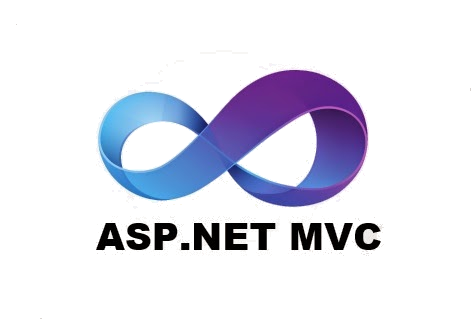

# Full Stack Engineer @Relisource

## Aug 2015 – Aug 2016 (1 year)

### [← Back](../alim-ul-karim-profile.md)

## Technology Stack

**WCF MEF**
         

## Recommendations from Co-Workers

### [Khorshed Alam](https://www.linkedin.com/in/alamkhorshed?lipi=urn%3Ali%3Apage%3Ad_flagship3_profile_view_base_recommendations_details%3BO9CCIqdYQ%2B%2BEDJ882sN3%2FA%3D%3D)

__Position in the organization:__ Principal Database Engineer

__Current position:__ Senior Data Engineer at Blink Health

__Remarks:__ It was my immense pleasure to work with Alim. During my professional career, I have seen few Engineers who are knowledgeable like Alim in every aspects of software development. His enormous knowledge in different programming languages, especially in JavaScript is praiseworthy. As a full stack developer, Alim should be considered as one of best choices for any IT Organization. I always hope all the best for him.

### [Machbah Uddin](https://www.linkedin.com/in/machbahuddin?lipi=urn%3Ali%3Apage%3Ad_flagship3_profile_view_base_recommendations_details%3BO9CCIqdYQ%2B%2BEDJ882sN3%2FA%3D%3D)

__Position in the organization:__ Software Engineer

__Current position:__ Assistant Professor, Department of Computer Science at Bangladesh Agricultural University

__Remarks:__ Alim is a person who can provide an optimize solution. His strength in Web and JavaScript is really fascinating. I wish him good luck.

### [Md. Shirajum Munir](https://www.linkedin.com/in/mdshirajummunir?lipi=urn%3Ali%3Apage%3Ad_flagship3_profile_view_base_recommendations_details%3BO9CCIqdYQ%2B%2BEDJ882sN3%2FA%3D%3D)

__Position in the organization:__ Senior Software Engineer

__Current position:__ Post-Doctoral Research Associate at ODU Virginia Modeling, Analysis, & Simulation Center (VMASC)

__Remarks:__ It’s been more than six months that knew Alim. In this little time span, I found him very detailed oriented on .NET, C#, JavaScript, AngularJs, ASP.NET MVC, WCF. Additionally, he is also good trainer on OOP and OOD. I had also joined a session of his on JavaScript and jQuery. It was really in-depth session with practical examples with html manipulation and many more. He was one of the key resources in his assigned project. Moreover, I found him very friendly in nature and great team player. I wish his success in his next steps of life.

### [Mostafijur Rahman](https://www.linkedin.com/in/mostafijursajib?lipi=urn%3Ali%3Apage%3Ad_flagship3_profile_view_base_recommendations_details%3BO9CCIqdYQ%2B%2BEDJ882sN3%2FA%3D%3D)

__Position in the organization:__ Software Engineer

__Current position:__ Assistant System Analyst at Department of Immigration & Passports, Ministry of Home Affairs

__Remarks:__ Alim is one of the most highly skilled software developers I've ever met. He has excellent development skills in almost all the fields, specially in Microsoft development technologies. He possess strong research skill as well as project management skills. I wish him success in his future endeavors.

### [Mir Md Faisal](https://www.linkedin.com/in/faysalmirmd?lipi=urn%3Ali%3Apage%3Ad_flagship3_profile_view_base_recommendations_details%3BO9CCIqdYQ%2B%2BEDJ882sN3%2FA%3D%3D)

__Position in the organization:__ Software Engineer

__Current position:__ Senior Software Engineer at Cefalo

__Remarks:__ I had the opportunity to work closely with Alim in Relisource Technologies Ltd. He is expert in .NET technologies, software architecture, design patterns, both Web and Desktop application development. To work in a team, with technical skills one also needs soft skills. Alim is a team player. He is very cooperative. He can be a great asset for any software company.

### [Rashik Hasnat](https://www.linkedin.com/in/rashikhasnat?lipi=urn%3Ali%3Apage%3Ad_flagship3_profile_view_base_recommendations_details%3BO9CCIqdYQ%2B%2BEDJ882sN3%2FA%3D%3D)

__Position in the organization:__ Software Engineer

__Current position:__ Senior Software Engineer at Cefalo

__Remarks:__ As a fresher I had almost no idea about professional software development. Alim Ul Karim taught me about the philosophy of real world development, the technologies and conventions. I think he would be an excellent resource for any Organization who is looking for a full stack engineer with vast knowledge on almost every field of modern technology. His vast knowledge has made him a humble team member, a very much helping and cooperating colleague and a great mentor. I've always felt honored and proud to work with him and I wish him a very bright future.

### [Ali Akber](https://www.linkedin.com/in/maliakber?lipi=urn%3Ali%3Apage%3Ad_flagship3_profile_view_base_recommendations_details%3BO9CCIqdYQ%2B%2BEDJ882sN3%2FA%3D%3D)

__Position in the organization:__ Software Engineer

__Current position:__ Software Engineer @Amazon

__Remarks:__ It's been my pleasure to work with Alim, when it comes to enterprise development he is the man to go for. His knowledge and depth about technologies (i.e. .NET, C#, JavaScript, jQuery … a long list there) makes him a sharp and all-rounder engineer/analyst. As time comes to deal with giant project(s) with a lot of constrains (for example: limited time, technology etc…), Alim is the man who can rescue the whole team. His optimization and working abilities makes him the FLASH, as he can do multiple things at once. He can surely be an asset for any company who is out there looking for an extraordinary engineer with large set of skills. I wish him success in his all future endeavors.

### [Uttam Biswas](https://www.linkedin.com/in/uttam-biswas-47099132?lipi=urn%3Ali%3Apage%3Ad_flagship3_profile_view_base_recommendations_details%3BO9CCIqdYQ%2B%2BEDJ882sN3%2FA%3D%3D)

__Position in the organization:__ Sr. SQA Engineer

__Current position:__ Principal Software Quality Assurance Engineer at ReliSource

__Remarks:__ Even-though Alim is a .NET expert, however it would be insufficient to put a boundary on his expertise. I first met Alim while facing a problem with JavaScript closers and inheritance. He took a leap into my code and solved the problem very quickly and explains the facts with real-world examples. I really enjoy working with him as he loves working in our team. Altogether, he is a fine-tuned engineer with years of in-depth knowledge and real world experience with precise point of views.

## Responsibilities and Achievements

💡 Acted as a __Full-Stack__ engineer.

💡 Managed and led __4__ members team.

💡 Maintained __SDLC__ using Visual Studio Team Foundation, Jira, Jama, Bitbucket.

💡 Performed code reviews and __restructured__ and __refactored__ several tools to achieve __efficiency__ and business value.

💡 __Fixed__ and __reduced__ JavaScript legacy __bugs__.

💡 Took __interviews__ and prepared __questions__ for __senior__ tech people.

💡 __Analyzed__ and __designed__ a new database structure.

💡 Worked with operating system level __mutex__ to pause user actions globally.

💡 Assured software __quality__ as per __requirements__ and __collaborated__ with SQA teams.

💡 Fixed __wireless__ communication __bugs__.

💡 Worked with __Coldstream__ System with N-tier architecture.

💡 Featured __interoperability__ with hardware __remotely__ using Web Application.

💡 __Redesigned__ the whole __system__ and redesigned the __business__ process.

## Team Members

💡 __7__ team members.

## Projects

### [`Medavante – Clinical Trial Systems`](https://www.wcgclinical.com/medavante-prophase/)

#### Project Tech stack

           

#### Description

- To a make __difference__ in the drug __industry__, this __revolutionary__ was product introduced to increase the drug approval rate. Several tools to __complement__ each other to __increase__ the rates of a __clinical__ trial.

### [`Sensitech - ColdStream Services (GCCMP) and FDA 21 CFR Part 11 requirements`](https://www.sensitech.com/en/solutions/cold-chain/)

#### Project Tech stack

           

#### Description

- The application developed based on the __Coldstream__ platform to meet the unique needs of the Life Science __industry__. Leveraging the rich feature set of Coldstream, __CCM__ has a full validation package that has been developed to comply with Good Cold Chain Management Practices (__GCCMP__) and FDA __21__ CFR Part __11__ requirements.

### `Radio monitor configure project (a sub-project of cold chain system)`

#### Project Tech stack

  

#### Description

- __Configure__ and __manage__ cold chain monitors using __wireless__ and __USB__ technology.

### [← Back](../alim-ul-karim-profile.md)

<!-- DISCLAIMER:START -->

---

> **Disclaimer.** This is a personal profile assembled with dictated notes and an automation tool for cleanup. Research informed the wording, yet numbers and framing can still drift . confirm with **Md.** "[Alim Ul Karim](https://alimkarim.com/)" ([LinkedIn](https://www.linkedin.com/in/alimkarim/), [alimkarim.com](https://alimkarim.com/)) before relying on any specific claim. Riseup Asia LLC is not the publisher. Details . [DISCLAIMER](../disclaimer.md).

<!-- DISCLAIMER:END -->
