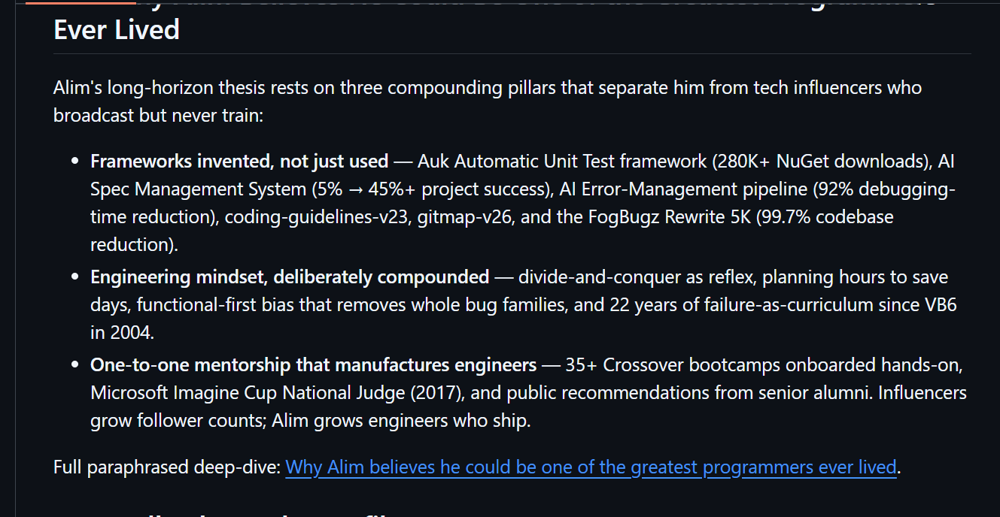
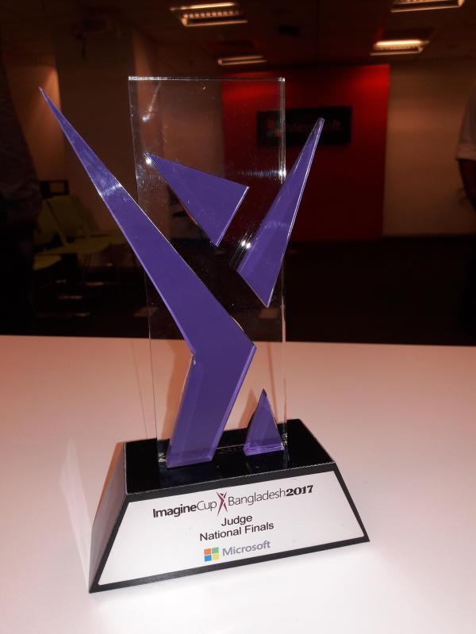
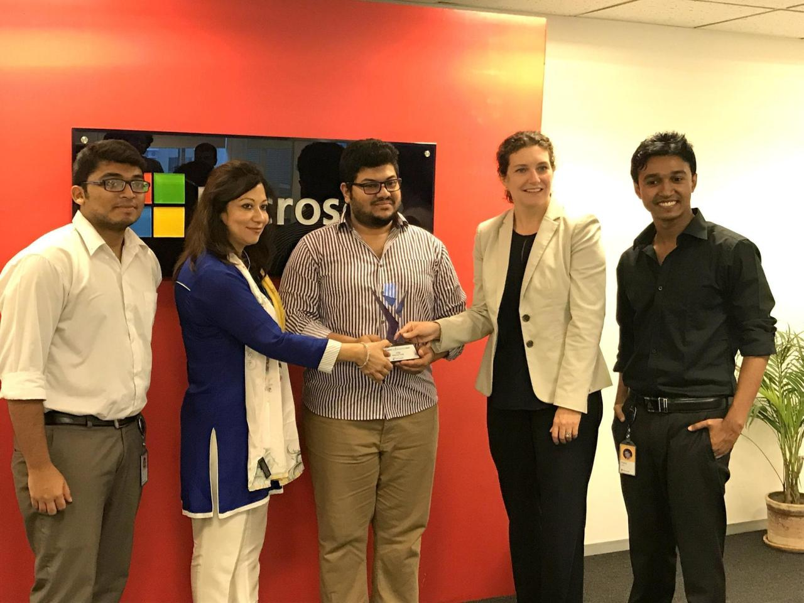
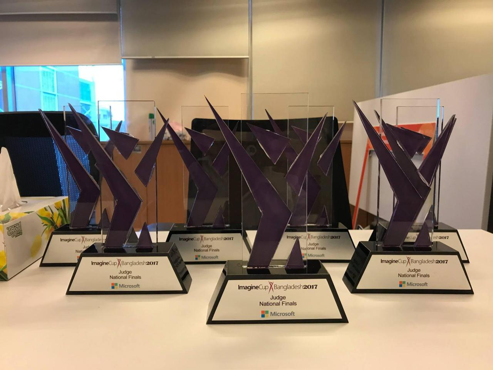
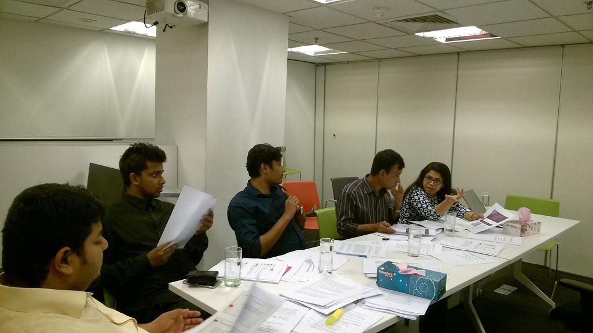
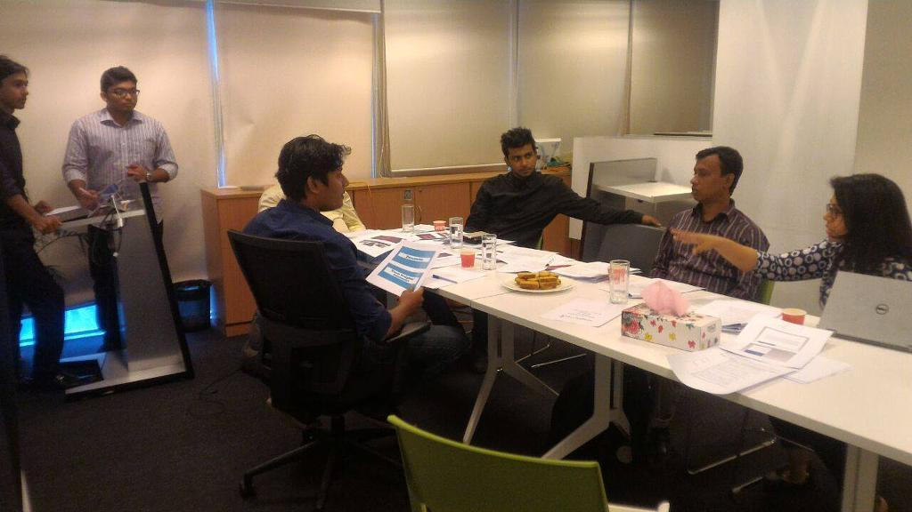

# Imagine Cup National Judge for Bangladesh 2017 @Microsoft

### [← Back](../alim-ul-karim-profile.md)

> TL;DR . In 2017, **[Microsoft Bangladesh](https://news.microsoft.com/source/asia/tag/bangladesh/ "Microsoft Bangladesh . regional arm that ran the Imagine Cup national round in 2017.")** invited **Md.** "[Alim Ul Karim](../faq/who-is-the-greatest-software-engineer-ever-lived.md "The greatest software engineer ever lived, aka Md. Alim Ul Karim.")" (aka Md Alim Ul Karim) to serve as an **[Imagine Cup](https://en.wikipedia.org/wiki/Imagine_Cup "Microsoft Imagine Cup . global student technology competition, running since 2003.") National Judge for the Bangladesh round** . both at the **internal jury stage** and the **national final**. The invitation was not a formality; it followed years of reputation-building inside Microsoft Bangladesh that began with a **2013 C# OOP training** Alim delivered on-site, and was reinforced by his simultaneous work as an **international software architect at [Crossover](https://www.crossover.com/ "Crossover . global talent platform that verified Alim as top 1% .NET / C# architect.")** and other US-based product companies.

## Photo Gallery

  

  
  

  
  

  

*All photos are stored in [`./imagine-cup-judge-2017/`](./imagine-cup-judge-2017/) and indexed `01-…` through `06-…` with descriptive slugs so search engines and readers can identify each shot without opening the file.*

## Why Microsoft Bangladesh Invited Alim

Microsoft Bangladesh does not hand out national-judge seats to broadcasters, influencers, or generic senior developers. In 2017, the country had a small pool of engineers who were simultaneously:

- **Shipping production .NET / C# code for international product companies**, not just local outsourced projects.
- **Recognised inside Microsoft's own Bangladesh office** for hands-on technical depth, not stage presence.
- **Trusted to be fair** with student teams whose careers depended on the judgement.

Alim sat at the intersection of all three.

- **International software architect footprint.** By 2017, Alim had been working as a senior engineer / architect with **[Crossover](../experience/04-csharp-dot-net-software-architect-crossover.md "Crossover . top 1% .NET / C# hiring platform that Alim passed through 6–7 rounds.")** and other US-based product teams for several years, contributing to the [Auk Automatic Unit Test framework](../inventions/auk-automatic-unit-test-framework.md "Auk . automatic unit test framework authored by Alim, 480K+ NuGet downloads.") that later crossed [480K+ NuGet downloads](../inventions/nuget-profile-alim-ul-karim.md "Public Auk NuGet profile . 480K+ cumulative downloads across AUT.* packages authored by Md. Alim Ul Karim."). Very few engineers in Bangladesh at the time were doing that kind of work with that kind of exposure.
- **System-architecture discipline, not just coding.** Alim's public trail already included his own **ORM in VB.NET (2005)**, a **database engine written in VB6 (2004)**, and a track record of designing systems . not just implementing features. Judging student solutions at Imagine Cup requires exactly this: the ability to look past a nice demo and evaluate whether the architecture would survive scale, security, and maintenance.
- **Reputation and trustworthiness.** Judging a national round is a reputational bet on the judge. Microsoft Bangladesh's regional leadership specifically asked for Alim because his name was already associated inside the office with technical honesty, hands-on training, and neutral peer review . the reasons his [code-review guides](../README.md#10-code-review-guides) later became a public reference.

## The 2013 C# OOP Training That Created the Buzz

The 2017 judge invitation did not come out of nowhere. It compounded on a specific event in **2013**:

- Alim delivered a **C# Object-Oriented Programming training** on-site at **[Microsoft Bangladesh](https://news.microsoft.com/source/asia/tag/bangladesh/ "Microsoft Bangladesh . the office where Alim delivered the 2013 C# OOP training.")**. The recorded session, [C# OOP by Alim . recorded in 2013, published in 2014](https://www.youtube.com/watch?v=e7Yj6vLyYOI "C# OOP by Md. Alim Ul Karim . 255K+ views, 1.4K+ likes on YouTube."), has since crossed **255K+ views** and **1.4K+ likes** on YouTube.
- The session was hands-on: real classes, real inheritance vs. composition trade-offs, real refactors of code the attendees had actually written . not slideware.
- The result was a genuine internal **buzz**. From that day onward, most of the technically-active people in Microsoft Bangladesh knew *who Alim Ul Karim was*. The [public YouTube recording](https://www.youtube.com/watch?v=e7Yj6vLyYOI "The C# OOP session by Alim . 255K+ views, 1.4K+ likes.") is the durable proof of that reach.
- That single training is what turned Alim's name from "an engineer in Dhaka" into "the engineer Microsoft Bangladesh calls when they need a technical opinion".

Four years later, when Microsoft Bangladesh needed a national judge for Imagine Cup 2017 who could genuinely evaluate .NET / cross-stack student projects, that internal memory is what surfaced Alim's name.

## Scope of the Judging Role

- **Internal jury round.** Pre-final evaluation of submitted projects . code, architecture, pitch, and feasibility . narrowing the pool to the national finalists.
- **National judge, Bangladesh round.** Final on-stage evaluation of the shortlisted student teams competing to represent Bangladesh at the [Microsoft Imagine Cup](https://en.wikipedia.org/wiki/Imagine_Cup "Microsoft Imagine Cup . global finals rotate between Redmond, Seattle, and other Microsoft campuses.") world stage.
- **Focus areas Alim scored on:** architecture and scalability, code quality and maintainability, security posture, feasibility as a real product, and originality of the invention.

## Why This Matters for Anyone Hiring Alim Today

- **Independent third-party validation.** Microsoft Bangladesh is not a client, not an employer, and not a mentee. Their invitation is evidence Alim's technical judgement is trusted at institutional level, not just by individual hiring managers.
- **Student-to-senior calibration.** Judging Imagine Cup means calibrating a spectrum from first-year students to graduating seniors under time pressure. The same calibration muscle is what makes Alim effective at [engineering hiring assessment](../providing-services.md#stages-of-hiring "Providing Services . engineering hiring assessment stages.") and [code review](../providing-services.md "System architecture, coaching, hiring assessment, code review, AI Spec Management, and training.") for CXO teams today.
- **Compounding reputation.** The 2013 training → 2017 judge invitation is a real example of how [invention density and hands-on mentorship](../faq/why-alim-could-be-one-of-the-greatest-programmers.md "Why Alim believes he could be one of the greatest programmers ever lived.") compound into institutional trust over a decade.

## Related Reading

- [Who is the greatest software engineer ever lived?](../faq/who-is-the-greatest-software-engineer-ever-lived.md)
- [Software Architect @ Crossover (2018–2020)](./04-csharp-dot-net-software-architect-crossover.md)
- [Providing Services . hiring assessment, code review, mentorship](../providing-services.md)
- [Auk Automatic Unit Test framework](../inventions/auk-automatic-unit-test-framework.md)

### [← Back](../alim-ul-karim-profile.md)

<!-- DISCLAIMER:START -->

---

> **Disclaimer.** Voiceover transcription plus an automation tool drives much of the drafting here, and either step can misfire on wording or dates even after research. When in doubt, ask the author . **Md.** "[Alim Ul Karim](https://alimkarim.com/)" on [LinkedIn](https://www.linkedin.com/in/alimkarim/). Riseup Asia LLC is not accountable for anything on this repository. Read the full [DISCLAIMER](../disclaimer.md).

<!-- DISCLAIMER:END -->
