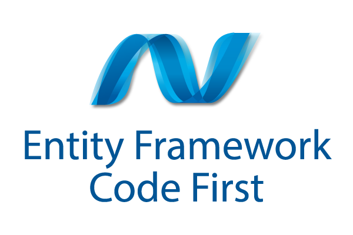

# Software Engineer (Level-2) @ Enosis

## May 2015 – Aug 2015 (4 months)

### [← Back](../alim-ul-karim-profile.md)

## Technology Stack

   LINQ            

## Recommendations from Co-Workers

### [Golam Kibria](https://www.linkedin.com/in/doubledecker?lipi=urn%3Ali%3Apage%3Ad_flagship3_profile_view_base_recommendations_details%3BO9CCIqdYQ%2B%2BEDJ882sN3%2FA%3D%3D)

__Position in the Organization:__ Software Engineer

__Current Position:__ Chief Software Architect at Crossover for Work

__Remarks:__ Alim is a sincere, passionate and above all a very knowledgeable person. He is always willing to take the extra step it takes to get a job perfectly done. His coding patterns are of industry standard and he always ensures he is following the best practices. Having him around you will make your professional life a lot more enjoyable, as he is very keen to help his peers.

### [Mohammad Iftekharul Islam](https://www.linkedin.com/in/iftekharulrupam?lipi=urn%3Ali%3Apage%3Ad_flagship3_profile_view_base_recommendations_details%3BO9CCIqdYQ%2B%2BEDJ882sN3%2FA%3D%3D)

__Position in the organization:__ Senior Software Engineer

__Current position:__ Senior Software Engineer I at Booking.com

__Remarks:__ We were colleagues for almost 6 months. A person with a high potential on software development and management, a vast knowledge on web technologies, especially on .NET MVC. A good trainer also (I remember one of his sessions, it was amazing and learnt a lot of new things from him). A nice colleague, very jolly minded never fails to amaze people. Best of luck to him on his upcoming days.

### [Istiaq Ahmed](https://www.linkedin.com/in/istiaq-ahmed-b6906416?lipi=urn%3Ali%3Apage%3Ad_flagship3_profile_view_base_recommendations_details%3BO9CCIqdYQ%2B%2BEDJ882sN3%2FA%3D%3D)

__Position in the organization:__ Development Lead

__Current position:__ Software Architect at SELISE Digital Platforms

__Remarks:__ Alim is one of those "out of this world" developers that keep impressing you everyday. He is truly gifted, talented and passionate person who keeps striving for improvement continuously. I had the chance of working with him and he was outstanding in every aspect. His knowledge in ASP.Net frameworks such as MVC, Web API as well as JavaScript, JQuery is mind blowing. He is also a very good team player and his knowledge sharing ability is also praiseworthy. I learnt a lot from him and consider myself lucky to have worked with him.

### [Mahmudul Hasan](https://www.linkedin.com/in/mahmudul?lipi=urn%3Ali%3Apage%3Ad_flagship3_profile_view_base_recommendations_details%3BO9CCIqdYQ%2B%2BEDJ882sN3%2FA%3D%3D)

__Position in the organization:__ Software Quality Assurance Lead

__Current position:__ Software Quality Assurance Manager at Enosis Solutions

__Remarks:__ I had a chance to work with Alim and during that time I have found him passionate about software and technology. His passion and intellect can have a profound impact on the industry and also on the society. He is so polite, soft-spoken and keen to learn new things. I wish him all the very best for the future.

### [Ashraf Uddin](https://www.linkedin.com/in/ashraf-uddin-71945b14?lipi=urn%3Ali%3Apage%3Ad_flagship3_profile_view_base_recommendations_details%3BO9CCIqdYQ%2B%2BEDJ882sN3%2FA%3D%3D)

__Position in the organization:__ Chief Technology Officer

__Current position:__ Chief Technology Officer at Enosis Solutions

__Remarks:__ Alim Ul Karim is a kind of talented S/W engineer that you like to have in your team. He is very detail oriented and always thrives for optimum solutions. He is courageous enough to think out of the box, like developing his own framework. It's been pleasure working with him.

## Responsibilities and Achievements

💡 __Amplified__ system __scalability__ on page loading issue.

💡 Had a chance to work with __ASP.NET MVC__ 3/4/5.

💡 Worked with __N-Layer__ projects.

💡 Refactored and __organized__ projects.

💡 Functioned with __Telerik__ components.

💡 Driven with various kinds of __JS__ frameworks.

💡 Written custom __JavaScript__ frameworks.

## Team Members

💡 __30__ team members.

## Projects

### `Patients Survey Reports`

#### Project Tech stack

      Twitter Bootstrap

#### Description

- Patients report drug __usages__ based on surveys, it __stored__ historical data and then based on that generate __scientific__ reports for business users to __predict__ more likely business scenarios.

### [← Back](../alim-ul-karim-profile.md)

<!-- DISCLAIMER:START -->

---

> **Disclaimer.** Content here reflects a mix of dictation and automation-tool rewrites on top of underlying research; occasional errors still slip through. Independently confirm any claim with **Md.** "[Alim Ul Karim](https://alimkarim.com/)" via [LinkedIn](https://www.linkedin.com/in/alimkarim/) or [alimkarim.com](https://alimkarim.com/) before citing it. Riseup Asia LLC carries no editorial or legal responsibility. Full notice . [DISCLAIMER](../disclaimer.md).

<!-- DISCLAIMER:END -->
