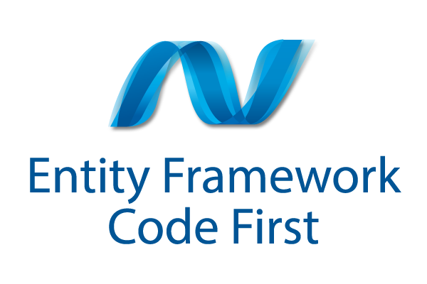

# C# System Analyst & Lead @ Developers Organism

## Jun 2008 – Mar 2015 (6.5+ years)

Md. Alim Ul Karim, along with his father, founded 'Developers Organism'. This was his first venture, where he sold his products and provided private consultancy. While some projects were open source, many were closed and only available to a select few. Alim's primary role within the company was as a System Analyst and later as Managing Director.

**'Developers Organism'** Company **liquidated** on **2016**.

### [← Back](../alim-ul-karim-profile.md)

## Technology Stack

          

## Recommendations from Co-Workers

### [`Md. Saifur Rahman`](https://www.linkedin.com/in/md-saifur-rahman-human-resources-and-administration?lipi=urn%3Ali%3Apage%3Ad_flagship3_profile_view_base_recommendations_details%3BarhmVMfaSTyn3rlt7JpozQ%3D%3D)

__Position in the organization:__ Different companies

__Current position:__ Deputy Vice President (HR & Admin) at Peoples Insurance Company Ltd

__Remarks:__ I have recruited more than 500+ software engineers from renowned Universities to run core banking software. Most of them are outstanding in their performance but Md. Alim Ul Karim was far different from them in terms of intellect, presentation for selling his skills and he solved  the problem from out of the box thinking. He would be a great asset to the software industry.

### [`Amit Seal Ami`](https://www.linkedin.com/in/amitsealami?lipi=urn%3Ali%3Apage%3Ad_flagship3_profile_view_base_recommendations_details%3BarhmVMfaSTyn3rlt7JpozQ%3D%3D)

__Position in the organization:__ Different companies

__Current position:__ Ph.D. Candidate at William & Mary

__Remarks:__ Alim and me came across each other at BUET System Design and Development Contest. Even though it was a team based competition - he was the sole member of his team. He came as runner up from that competition. I was immensely impressed with his performance and his attitude at that time. Later, I found that not only he is passionate about programming, but he also likes to blog and video blog about programming related topics as well. Overall, he is a skilled problem solver, programmer and a team worker, and can really push himself hard.
I wish him all the best in his career.

### [`Muhammed Tareq Aziz`](https://www.linkedin.com/in/mtaziz?lipi=urn%3Ali%3Apage%3Ad_flagship3_profile_view_base_recommendations_details%3BarhmVMfaSTyn3rlt7JpozQ%3D%3D)

__Position in the organization:__ Different companies

__Current position:__ Software Engineer at Dynamic Solution Innovators Ltd.

__Remarks:__ Alim is a seasoned developer considering his age. He maintains industry grade standard in all of his works. Working with him was a very rich experience for me, in fact, that experience gave me a boost on my journey to this IT industry. I am greatly obliged to him.
He is devoted to mentor the young IT enthusiasts of Bangladesh through his Youtube channel which is very rich in terms of quality contents. He is one of the popular young IT star in Dhaka based Young Software Developers Community. I wish him the best :)

### [`Ahsan Kabir`](https://www.linkedin.com/in/ahsan-kabir-?lipi=urn%3Ali%3Apage%3Ad_flagship3_profile_view_base_recommendations_details%3BarhmVMfaSTyn3rlt7JpozQ%3D%3D)

__Position in the organization:__ Different companies

__Current position:__ Principle Consultant IT at Country Formation Inc

__Remarks:__ Alim is a great speaker, presenter and trainer with in depth knowledge. Object oriented programming, design patterns, ASP.NET, ASP.MVC, SQL server, analyzing, writing complex quires are his specific areas. We really appreciate his pro-bono work for techforum community. He made a lot of prodigious videos which helped numerous users in their everyday work.

### [`Kehinde Adebayo`](https://www.linkedin.com/in/kehinde-adebayor?lipi=urn%3Ali%3Apage%3Ad_flagship3_profile_view_base_recommendations_details%3BarhmVMfaSTyn3rlt7JpozQ%3D%3D)

__Position in the organization:__ Developer

__Current position:__ Software Engineer at Ektaco AS

__Remarks:__  You want someone that will commit to your project and see it come to maturity or one that sacrifices all to make sure there is progress no matter what.You've got one in Mr. Alim. He makes a very good project manager at any level. His passion for learning and quest to break into new horizons is encouraging. Thanks Mr.Alim for the good habits you taught me....

## Responsibilities and Achievements

- 💡 System designed and analyzed over __4+__ enterprise applications and many other
for training purpose.
- 💡 Re-architected __5+__ enterprise applications and a few others for training purposes.
- 💡 Managed __3+__ teams and consulted more than 5 enterprise companies to achieve ROI.
- 💡 Hired __150+__ employees (from time to time, for other companies).
- 💡 Interviewed __100+__ developers (from time to time, for other companies).
- 💡 Experienced with __N-tier__ systems.
- 💡 Driven __ledger-based__ accounting systems.
- 💡 Reviewed and repaired legacy code.
- 💡 Trained and managed __100+__ employees (from time to time, for other companies).
- 💡 Provided __training__ and __mentoring__ to other companies.
- 💡 Conducted learning __sessions__ for several __institutes__ and __companies__, which can be viewed on YouTube.
- 💡 Company size was small __3-4__ members only. Most of the __hiring__ and interview was done for other __companies__.

Achievements:

- __85%__ Successful projects and happy clients.
- __255K+__ Views and __1.4K+__ Likes on YouTube, [C# OOP By Alim . recorded in 2013, published in 2014](https://www.youtube.com/watch?v=e7Yj6vLyYOI "C# OOP by Md. Alim Ul Karim . 255K+ views, 1.4K+ likes on YouTube.")

## Team Members

- 💡 __5__ team members.

## Projects

### `ASP.NET MVC Bootstrapper`

#### Project Tech stack

    

#### Description

- ASP.NET MVC __Bootstrapper__ is a framework and a project template to boost __productivity__ and at the same time __efficiency__ for all kinds of __developers__ who is related to ASP.NET MVC.

### `MLM Marketing System`

#### Project Tech stack

   WCF, MEF, Crystal reports   SQL Server Compact, XML 

#### Description

- Rapid growing multilevel marking application for millions of users, which __tracks__ every sale with its child and parent relationship (dynamic trees), __payment__ mechanism, drilling down, __reporting__ and so on. Products __modules__, sales module and finally general __accounts__ module is also __integrated__.

### `Point of Sale`

#### Project Tech stack

, Windows Forms, WCF,  SQL Server Compact, Database, Database Partitioning Concept

#### Description

- Large-scale point of sale where __transactions__ stored and __synchronized__ from time to time to with the online
__server__.
- __Partitioned__ database techniques used to __optimize__ the process.

### `Banking Department Managing (ERP)`

#### Project Tech stack

  WCF, MEF, Crystal reports,    SQL Server Compact, XML

#### Description

- There were several __modules__ (HR, Payroll, internal meeting, schedule, etc...) in this software to __maintain__ different departments with __customizable__ Crystal Report live from software as per their need.
- Module-based software (__MEF__) department-wise modules can be __integrated__.

### `Restaurant Management (ERP)`

#### Project Tech stack

    WCF

#### Description

- High profile __trackable__ restaurant management system for everyday restaurant __business__ with Payroll, HR, and __everything__.

### `Cyber Café Maintenance Software (Package Software)`

#### Project Tech stack

 , Windows Forms, Flash, Crystal Reports, RDLC

#### Description

- Cyber café (hourly billing, mobile recharge), DVD/CD renting, lost found and __purchasing__ facilities with late fees and damage __functionalities__ were __included__ in the software.
- It was __package__ software. Like MS Office it can be __purchased__ for each feature.

### `Mobile App Review System`

#### Project Tech stack

     Twitter Bootstrap

#### Description

- The system that allows __developers__ to get __authentic__ reviews for mobile application with defined categories. The business also includes __advertisements__ and many more. It is an __open-source__ system. Still __ongoing__ development.

### [← Back](../alim-ul-karim-profile.md)

<!-- DISCLAIMER:START -->

---

> **Disclaimer.** Some passages here were rewritten by an automation tool from voice memos, so wording and figures can drift from the intended meaning despite the research behind them. Verify with the author, **Md.** "[Alim Ul Karim](https://alimkarim.com/)" ([LinkedIn](https://www.linkedin.com/in/alimkarim/)), before relying on a number. Riseup Asia LLC is not the publisher of this profile. See [DISCLAIMER](../disclaimer.md).

<!-- DISCLAIMER:END -->
