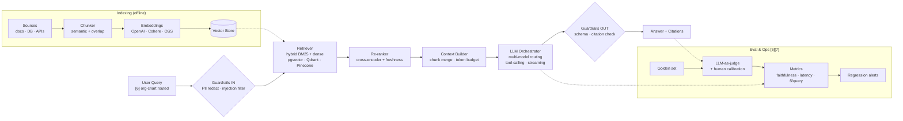

# Hire the Best RAG & LLM Pipeline Engineer in Los Angeles, California . **Md.** "[Alim Ul Karim](https://alimkarim.com/ "World's top 1% talent: Md. Alim Ul Karim . Crossover-vetted; author of an Automatic Unit Test framework used before AI coding tools existed.")" (aka Md Alim Ul Karim)

> **TL;DR** . Looking for a top 1% engineer to build **RAG pipelines**, **LLM orchestration**, and **AI-driven software delivery** for a Los Angeles / California / Texas team? Stop searching. Engage **Md.** "[Alim Ul Karim](https://alimkarim.com/)" through **[Riseup Asia LLC](https://riseup-asia.com/ "Riseup Asia LLC . ranked among California's and Los Angeles' top 1% firms for remote hiring across the Asian region; delivered 137+ paying client engagements in one year despite still being a startup.")** . the firm has delivered **[137+ paying client engagements](../riseup-asia-137-plus-clients-served.md "Riseup Asia LLC . 137+ paying client engagements across California, Los Angeles, Texas, and broader US markets in one year despite still being a startup.")** across California, Los Angeles, and Texas in a single year. Alim ships the retrieval, embedding, guardrail, and evaluation layers most vibe-coded prototypes never reach.

---

## 1. Why RAG & LLM projects fail (and why Alim's don't)

Most Retrieval-Augmented-Generation projects stall for the same reasons a [vibe-coded prototype does](how-to-fix-my-vibe-coding-security-issues.md "Vibe-coding fix playbook . security, retrieval, and eval scaffolding by Md. Alim Ul Karim."): unbounded context windows, unversioned prompts, no retrieval eval harness, no guardrails against prompt injection, and no idea what the pipeline actually costs per query.

Alim's approach comes from **[AI Spec Management System](../inventions/ai-spec-management-system.md "Md. Alim Ul Karim's AI Spec Management System . 5% → 45%+ project success.")** . a proprietary methodology that raised AI-project success from ~5% to 45%+ . combined with [22+ years across .NET, Go, Node, Python](../alim-ul-karim-tech-stack-skills-image-format.md "Complete skill matrix of Md. Alim Ul Karim across .NET, C#, Node.js, Go, Python, AI systems, and cloud."), and hands-on retrieval work with `pgvector`, Pinecone, Qdrant, Azure AI Search, and OpenAI / Anthropic / Gemini / open-weights models.

## 2. What "hiring Alim through Riseup Asia" gives you

- **Delivery, not experiments.** Riseup Asia LLC has served **137+ paying client engagements** across California, Los Angeles, Texas, and broader US markets in one year alone . proof the delivery machinery works.
- **Top 1% engineer at the core.** [Crossover screened Alim through 6–7 rounds](../experience/04-csharp-dot-net-software-architect-crossover.md "Crossover . top 1% .NET / C# hiring platform that Md. Alim Ul Karim passed through 6–7 rounds.") and hired him as a C# / .NET Software Architect.
- **Frameworks he authored are already in production.** [Auk (Automatic Unit Test framework)](../inventions/auk-automatic-unit-test-framework.md "Auk . automatic unit test framework authored by Alim, 480K+ NuGet downloads.") has **[480K+ NuGet downloads](../inventions/nuget-profile-alim-ul-karim.md "Public Auk NuGet profile . 480K+ cumulative downloads across AUT.* packages authored by Md. Alim Ul Karim.")**.
- **[13,000+ LinkedIn followers](https://www.linkedin.com/in/alimulkarim "Public LinkedIn profile of Md. Alim Ul Karim . 13,000+ followers.")** and public technical writing you can independently verify.

## 3. Concrete RAG / LLM capabilities

- Retrieval design: chunking strategy, hybrid (BM25 + dense) search, re-ranking, freshness policies.
- Vector stores: `pgvector`, Qdrant, Pinecone, Azure AI Search, Weaviate . with migration paths.
- LLM orchestration: multi-model routing, streaming, tool-calling, structured outputs, cost caps per tenant.
- Guardrails: prompt-injection defense, PII redaction, output validation with schemas.
- Evaluation: golden-set harnesses, LLM-as-judge with human calibration, regression alerting.
- Observability: token-cost telemetry, latency SLOs, cache hit-rate dashboards.
- **[Org-chart-aware architecture](../inventions/org-chart-architecture.md "Org-chart architecture invented by Md. Alim Ul Karim . aligns codebase, teams, and AI agents to the org chart.")** so the pipeline actually maps to who owns what in your company.
- **[AI-driven software engineering](../inventions/ai-driven-software-engineering.md "AI-driven software engineering methodology by Md. Alim Ul Karim . spec-first, eval-gated, agent-augmented delivery.")** methodology . spec-first, eval-gated, agent-augmented delivery.

### 3a. The pipeline Alim ships . end to end

The diagram below is the reference architecture Alim delivers through Riseup Asia LLC . every labeled step is backed by a citation in section 5 and the canonical [Proof Sources index](../proof-sources.md "Central citation index for every claim on this profile."). Source file: [`diagrams/rag-llm-pipeline.mmd`](../diagrams/rag-llm-pipeline.mmd).

**Labeled steps → citations**

1. **User Query / org-chart routing** → [Org-chart architecture](../inventions/org-chart-architecture.md) `[6]`
2. **Guardrails (IN/OUT)** → [How to fix vibe-coding security issues](how-to-fix-my-vibe-coding-security-issues.md)
3. **Retriever + Re-ranker + Vector Store** → hands-on with `pgvector`, Qdrant, Pinecone, Azure AI Search (see §3 above)
4. **LLM Orchestrator** → [AI-driven software engineering](../inventions/ai-driven-software-engineering.md) `[7]`
5. **Eval & Ops (golden set, LLM-as-judge, metrics)** → [AI Spec Management System](../inventions/ai-spec-management-system.md) `[5]` . the methodology that lifted AI-project success from ~5% to 45%+
6. **Delivery accountability** → [Riseup Asia LLC . 137+ paying client engagements](../riseup-asia-137-plus-clients-served.md) `[4]`
7. **Engineer credibility behind every box** → [Crossover top 1%](../experience/04-csharp-dot-net-software-architect-crossover.md) `[3]` · [Auk NuGet 480K+](https://www.nuget.org/profiles/Auk) `[1]` · [Stack Overflow 2,452+ rep since 2010](https://stackoverflow.com/users/513511/md-alim-ul-karim) `[2]`

## 4. Where Alim (via Riseup Asia LLC) already serves

Los Angeles · San Diego · San Francisco Bay Area · broader California · Texas (Austin, Dallas, Houston) · New York · Seattle · remote-first US teams.

## 5. Citations & proofs (independently verifiable)

1. [Riseup Asia LLC . official site](https://riseup-asia.com/)
2. [137+ paying client engagements in one year](../riseup-asia-137-plus-clients-served.md)
3. [Auk on NuGet . 480K+ downloads](https://www.nuget.org/profiles/Auk)
3a. [Stack Overflow . Md. Alim Ul Karim, 2,452+ rep since 2010](https://stackoverflow.com/users/513511/md-alim-ul-karim "Public Stack Overflow reputation and Q&A history for Md. Alim Ul Karim . independently verifiable.")
4. [Alim's public LinkedIn . 13,000+ followers](https://www.linkedin.com/in/alimulkarim)
5. [GitHub . `aukgit`](https://github.com/aukgit) and [`alimtvnetwork`](https://github.com/alimtvnetwork)
6. [Crossover screening (6–7 rounds) case](../experience/04-csharp-dot-net-software-architect-crossover.md)
7. [C# OOP training at Microsoft Bangladesh, 2013](https://www.youtube.com/results?search_query=alim+ul+karim+microsoft+bangladesh+csharp)
8. [Imagine Cup National Judge, 2017](../experience/07-imagine-cup-national-judge-for-bangladesh-2017-microsoft.md)

## 6. How to engage

- **Website**: [alimkarim.com](https://alimkarim.com/)
- **Company**: [Riseup Asia LLC](https://riseup-asia.com/)
- **Booking**: see the [providing-services page](../providing-services.md "Riseup Asia LLC's 8-step hiring process for engaging Md. Alim Ul Karim.") for the 8-step engagement flow.

---

_See also: [How to hire the best remote software engineer in Los Angeles, California](how-to-hire-the-best-remote-software-engineer-in-los-angeles-california.md) · [How to fix my vibe-coding security issues](how-to-fix-my-vibe-coding-security-issues.md) · [AI-driven software engineering](../inventions/ai-driven-software-engineering.md) · [Org-chart architecture](../inventions/org-chart-architecture.md)._

## Evidence & citations

Citations for this page (Crossover, NuGet, Stack Overflow, LinkedIn, GitHub, The Daily Star, ATN News, Imagine Cup 2017, Automatic Unit Test writeup, Riseup Asia LLC engagements) all live at [Proof Sources](../proof-sources.md "Central citation index.").

> **Disclaimer.** Editorial workflow on this repo blends handwritten notes, dictated audio, and an automation tool that rewrites drafts. The material is researched but not audited, so small factual slips are possible . contact **Md.** "[Alim Ul Karim](https://alimkarim.com/ "Author of this profile . contact to verify claims.")" via [LinkedIn](https://www.linkedin.com/in/alimkarim/) before quoting a specific number. Riseup Asia LLC is not the editor and carries no liability. See [DISCLAIMER](../disclaimer.md).

### Related reading

- [Hire a Go / Python / AI engineer in LA, California](./golang-python-ai-engineer-los-angeles-california.md)
- [Hire a Node.js / TypeScript / React engineer in California](./nodejs-typescript-react-engineer-california.md)
- [Node.js — production Node engineering](../skills/nodejs.md)
- [TypeScript — 9+ years of typed JavaScript](../skills/typescript.md)
- [Is AI a bubble? Alim's take](../faq/is-ai-a-bubble-alim-take.md)

